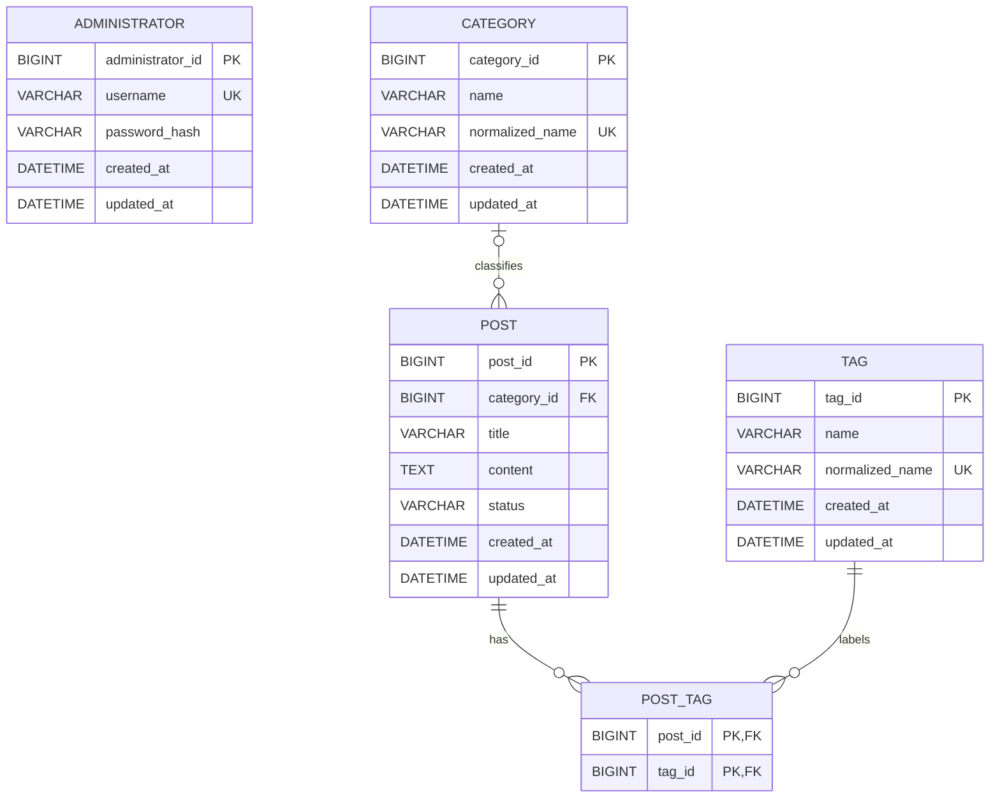

# 데이터베이스 설계서 및 ERD

## 확정된 데이터 제약

- 관리자 계정은 하나만 운용하며 최초 계정은 환경변수 기반으로 생성한다.
- 게시글 상태는 `DRAFT`와 `PUBLISHED`만 사용한다.
- 게시글과 카테고리는 선택적 다대일 관계다. 게시글은 카테고리를 가지지 않거나 하나만 가진다.
- 게시글과 태그는 다대다 관계이며 게시글 하나에 연결할 수 있는 태그는 최대 5개다.
- 카테고리와 태그의 정규화한 이름은 각각 중복될 수 없다.
- 사용 중인 카테고리와 태그 삭제는 차단한다.
- 게시글은 물리 삭제하며 삭제 복구를 위한 상태나 시각은 두지 않는다.

## 전역 데이터베이스 정책

### 실행 환경

- `local` Profile은 H2 메모리 데이터베이스를 사용하고 실행할 때마다 Schema를 새로 만든다.
- `dev` Profile은 MySQL을 사용하고 `DEV_DB_URL`, `DEV_DB_USERNAME`, `DEV_DB_PASSWORD`로 접속정보를 전달한다.
- `test` Profile은 H2를 사용하고 Test마다 Schema를 생성한 뒤 제거한다.
- Hibernate `ddl-auto`는 local `create`, dev `update`, test `create-drop`을 사용한다.
- H2 Console은 local에서만 활성화한다.
- `data.sql`로 관리자 또는 업무 데이터를 초기화하지 않는다.

### 명명 규칙

- 테이블명은 단수형 `snake_case`를 사용하고 `_tb` 접미사를 붙이지 않는다.
- 기본키는 `테이블명_id` 형식을 사용한다. 예: `post_id`.
- 외래키는 참조하는 기본키와 같은 이름을 사용한다.
- 일반 컬럼명은 `snake_case`를 사용한다.

### 공통 컬럼과 시간

- `administrator`, `post`, `category`, `tag`에 `created_at`, `updated_at`을 둔다.
- Java Type은 `LocalDateTime`을 사용하고 시간대 기준은 `Asia/Seoul`로 통일한다.
- 이름이나 내용을 복제하는 Snapshot 컬럼은 사용하지 않는다.
- 논리 삭제 컬럼을 사용하지 않는다.

### 상태값

- 게시글 상태는 `VARCHAR(20)`에 Java Enum 이름 `DRAFT`, `PUBLISHED`를 문자열로 저장한다.
- Enum 순서가 바뀌어도 데이터 의미가 변하지 않도록 숫자 저장을 사용하지 않는다.

## JPA 감사 시각 자동화

- Spring Data JPA Auditing을 사용한다.
- `@MappedSuperclass` 공통 Class에 `createdAt`, `updatedAt`을 선언하고 `@CreatedDate`, `@LastModifiedDate`를 적용한다.
- JPA 설정에서 `@EnableJpaAuditing`을 활성화한다.
- 공통 Class에 `AuditingEntityListener`를 연결한다.
- `administrator`, `post`, `category`, `tag` Entity가 공통 Class를 상속한다.
- Service, Controller와 DTO에서 생성·수정 시각을 직접 입력하지 않는다.
- 작성자·수정자 ID 감사는 현재 단일 관리자 범위에 필요하지 않으므로 `AuditorAware`를 사용하지 않는다.

Hibernate 전용 `@CreationTimestamp`, `@UpdateTimestamp`보다 Spring Data JPA의 감사 의도가 분명하고, 향후 작성자·수정자 감사 정보로 확장하기 쉽다는 점을 추천 근거로 삼는다.

## 테이블 설계

### administrator

최초 관리자 계정 하나를 저장한다.

- 애플리케이션 시작 시 관리자가 없을 때만 `INITIAL_ADMIN_USERNAME`, `INITIAL_ADMIN_PASSWORD`로 생성한다.
- 관리자 비밀번호는 `spring-security-crypto`의 BCrypt로 Hash한 값만 저장한다.
- 관리자가 없고 초기 관리자 환경변수도 없으면 애플리케이션 시작을 실패 처리한다.
- Test는 실제 비밀정보가 아닌 Test 전용 초기 관리자 값을 사용한다.

| 컬럼 | 데이터 타입 | NULL | Key·제약조건 | 설명 |
|---|---|---|---|---|
| `administrator_id` | `BIGINT` | 불가 | PK, Auto Increment | 관리자 ID |
| `username` | `VARCHAR(50)` | 불가 | UNIQUE | 로그인 아이디 |
| `password_hash` | `VARCHAR(255)` | 불가 |  | 단방향 Hash 비밀번호 |
| `created_at` | `DATETIME(6)` | 불가 |  | 생성 시각 |
| `updated_at` | `DATETIME(6)` | 불가 |  | 수정 시각 |

최초 실행 시 환경변수로 전달된 관리자 정보로 계정이 없을 때만 생성한다. 실제 비밀번호는 데이터베이스와 설정 파일에 평문으로 저장하지 않는다.

### category

게시글을 선택적으로 분류하는 카테고리를 저장한다.

| 컬럼 | 데이터 타입 | NULL | Key·제약조건 | 설명 |
|---|---|---|---|---|
| `category_id` | `BIGINT` | 불가 | PK, Auto Increment | 카테고리 ID |
| `name` | `VARCHAR(50)` | 불가 |  | 화면 표시 이름 |
| `normalized_name` | `VARCHAR(50)` | 불가 | UNIQUE | 공백 제거·영문 소문자 변환 이름 |
| `created_at` | `DATETIME(6)` | 불가 |  | 생성 시각 |
| `updated_at` | `DATETIME(6)` | 불가 |  | 수정 시각 |

게시글에서 사용 중인 카테고리는 삭제할 수 없다.

### tag

게시글의 여러 주제를 나타내는 태그를 저장한다.

| 컬럼 | 데이터 타입 | NULL | Key·제약조건 | 설명 |
|---|---|---|---|---|
| `tag_id` | `BIGINT` | 불가 | PK, Auto Increment | 태그 ID |
| `name` | `VARCHAR(50)` | 불가 |  | 화면 표시 이름 |
| `normalized_name` | `VARCHAR(50)` | 불가 | UNIQUE | 공백 제거·영문 소문자 변환 이름 |
| `created_at` | `DATETIME(6)` | 불가 |  | 생성 시각 |
| `updated_at` | `DATETIME(6)` | 불가 |  | 수정 시각 |

게시글에서 사용 중인 태그는 삭제할 수 없다.

### post

초안과 공개 게시글을 저장한다.

| 컬럼 | 데이터 타입 | NULL | Key·제약조건 | 설명 |
|---|---|---|---|---|
| `post_id` | `BIGINT` | 불가 | PK, Auto Increment | 게시글 ID |
| `category_id` | `BIGINT` | 허용 | FK | 선택한 카테고리 ID |
| `title` | `VARCHAR(200)` | 불가 |  | 게시글 제목 |
| `content` | `TEXT` | 불가 |  | 게시글 본문 |
| `status` | `VARCHAR(20)` | 불가 | CHECK | `DRAFT` 또는 `PUBLISHED` |
| `created_at` | `DATETIME(6)` | 불가 |  | 생성 시각 |
| `updated_at` | `DATETIME(6)` | 불가 |  | 수정 시각 |

`category_id`는 `category.category_id`를 참조한다. 사용 중인 카테고리 삭제를 막기 위해 `ON DELETE RESTRICT`를 사용한다. 게시글은 하나의 관리자만 작성하므로 관리자 외래키를 두지 않는다.

### post_tag

게시글과 태그의 다대다 관계를 저장한다.

| 컬럼 | 데이터 타입 | NULL | Key·제약조건 | 설명 |
|---|---|---|---|---|
| `post_id` | `BIGINT` | 불가 | PK, FK | 게시글 ID |
| `tag_id` | `BIGINT` | 불가 | PK, FK | 태그 ID |

`post_id`, `tag_id`를 복합 기본키로 사용해 같은 태그의 중복 연결을 막는다. 게시글 삭제 시 연결 행은 `ON DELETE CASCADE`로 함께 삭제한다. 사용 중인 태그 삭제를 막기 위해 `tag_id`에는 `ON DELETE RESTRICT`를 사용한다. 게시글당 태그 최대 5개 규칙은 Service에서 검증하고 자동 Test로 보장한다.

## 제약조건과 인덱스

- `administrator.username`, `category.normalized_name`, `tag.normalized_name`에 UNIQUE 제약조건을 둔다.
- `post.status`는 `DRAFT`, `PUBLISHED`만 허용하는 CHECK 제약조건을 둔다.
- 공개 목록과 최신순 정렬을 위해 `post(status, created_at)` 복합 인덱스를 둔다.
- 카테고리별 공개 목록을 위해 `post(category_id, status, created_at)` 복합 인덱스를 둔다.
- 태그별 게시글 조회를 위해 `post_tag(tag_id, post_id)` 복합 인덱스를 둔다.
- `post_tag(post_id, tag_id)` 복합 기본키는 게시글 기준 태그 조회 인덱스로도 사용한다.

## ERD

`ADMINISTRATOR`는 단일 계정이며 게시글 작성자 관계를 별도 저장하지 않으므로 다른 테이블과 연결하지 않는다.

## JPA Mapping

- 모든 연관관계는 `FetchType.LAZY`를 사용한다.
- `Post`가 선택적 `Category` 외래키를 가진다. Category에는 Post 삭제 Cascade를 적용하지 않는다.
- `PostTag`를 명시적 연결 Entity로 사용하고 `@ManyToMany`를 사용하지 않는다.
- `PostTagId`는 `postId`, `tagId`를 가진 `@Embeddable` 복합키로 구성하고 `PostTag`에서 `@EmbeddedId`, `@MapsId`를 사용한다.
- `Post`의 PostTag Collection에는 Cascade와 `orphanRemoval`을 적용한다.
- Tag에는 PostTag 또는 Post 삭제 Cascade를 적용하지 않는다.
- 게시글 목록과 상세 조회는 Category와 PostTag·Tag를 Fetch Join 또는 `@EntityGraph`로 조회해 N+1을 방지한다.
- Pagination이 없으므로 Collection Fetch Join의 Pagination 제약은 현재 범위에 적용되지 않는다.
